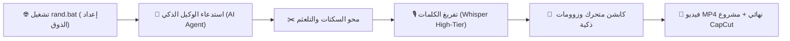

# 🎬 ReelForge AI
### محرك مونتاج الريلز والفيديوهات الإعلانية بالذكاء الاصطناعي — بنقرة واحدة
> **The Autonomous AI Video & Reels Editor for Content Creators & Agencies**  
> *نظام مفتوح المصدر للمونتاج الآلي عبر وكلاء الذكاء الاصطناعي (AI Coding Agents)*

[](LICENSE)
[](https://www.python.org/)
[](https://github.com/islamlal12)
[]()

---

## 🌟 الفكرة ببساطة

تخيل أن لديك **مونتير محترف وخارق للعادة** يجلس داخل جهازك:
1. **تفتح صفحة الإعدادات بنقرة واحدة** عبر `rand.bat` أو `run.bat` (أو `rand.sh` لماك/لينكس) لتختار ألوانك وخطك وشكل الكابشن المفضل عبر واجهة استوديو عصرية في المتصفح.
2. **تطلب من وكيل الذكاء الاصطناعي** (مثل Claude Code أو Hermes أو Antigravity): *"منتج هذا الفيديو"* أو ترسل له المقطع الخام.
3. يكتشف الوكيل بذكاء اللحظات الصامتة والتلعثم وتكرار الكلمات، فيقصها ويمحوها في ثوانٍ.
4. يفرّغ كل كلمة بأعلى دقة ممكنة باستخدام أقوى موديلات **Whisper**، ويكتبها بخط عربي عصري جذاب (`Cairo` أو خطك المفضل) وألوان متناسقة وعالية التباين.
5. يضبط نقاء وقوة الصوت لمعيار البث العالمي (`-14.0 LUFS`).
6. يسلمك فيديو جاهز للنشر فوراً على **إنستغرام، تيك توك، ويوتيوب شورتس**، مع مشروع **CapCut** مفتوح للتعديل اليدوي إن أردت!



---

## ⚡ البداية السريعة (بدون أي احتكاك تقني)

### 1. ضبط ذوقك وهوية الفيديوهات
- **اضغط مرتين على ملف `rand.bat` أو `run.bat` (لمستخدمي ويندوز)** أو نفّذ `./rand.sh` (لماك ولينكس).
- ستفتح لك تلقائياً صفحة استوديو عصرية في المتصفح على الرابط: `http://127.0.0.1:4321/`
- اختر لوحة ألوانك المفضلة، الخط، وشكل الكابشن، مع معاينة حية مباشرة تتغير لحظياً على الجانب المكتبي.
- اضغط **«حفظ»**. سيبقى الخادم في انتظار أوامر المونتاج من وكيل الذكاء الاصطناعي.

### 2. إنتاج الفيديو عبر وكيل الذكاء الاصطناعي (AI Agent)
فقط اطلب من الوكيل في الشات:
```
منتج هذا المقطع: my_video.mp4
```
أو
```
حوّل فيديو المقابلة src.mov إلى ريلز إعلاني 9:16 مع كابكت
```
سيتولى الوكيل قراءة إعداداتك المحفوظة، فحص الفيديو، وتطبيق كافة مراحل المونتاج حتى تسليم المقطع النهائي.

---

## 💎 المعايير الاحترافية المدمجة في المحرك

| الميزة | ما الذي تفعله؟ | الفائدة لك |
| :--- | :--- | :--- |
| **محو التلعثم والسكتات تلقائياً** | يتعرف على البدايات المتعثرة، والكلمات المكررة مرتين، والوقفات الطويلة ويقصها بسلاسة. | كلامك يخرج سريعاً، واثقاً، ومشدوداً بدون أي ملل (Zero Hesitation). |
| **تفريغ صوتي عالي الدقة (Whisper)** | استخدام أعلى فئات نماذج Whisper (`large-v3-turbo` أو `large-v3`) مع تنزيل تلقائي عند الحاجة. | دقة متناهية في التقاط الكلمات العامية والفصحى بتوقيت أجزاء الثانية. |
| **ألوان محايدة عصرية وخطوط فخمة** | نمط افتراضي جذاب (Slate Dark & Sky Blue مع خط Cairo)، مع قابلية التخصيص الكامل لأي علامة تجارية. | مظهر احترافي عالمي يناسب مختلف أنواع المحتوى والشركات. |
| **صوت استوديو إذاعي (-14.0 LUFS)** | معايرة الصوت تلقائياً لمعيار البث الصارم للمنصات الدولية. | صوت متوازن ونقي تماماً، لا ينخفض في الهواتف ولا يتم كتمه من الخوارزميات. |
| **احترام المنطقة الآمنة (1080×1080)** | وضع كل النصوص والوجوه داخل المربع الآمن تماماً. | لن يختفي الكابشن أو جزء من وجهك خلف أزرار الإعجاب أو الوصف في تيك توك وإنستغرام. |
| **تصدير كاب كت المباشر (`CapCut`)** | استخراج مشروع CapCut مفتوح بكل طبقات النصوص والقصات والزوومات بنقرة واحدة. | حرية كاملة للتعديل اليدوي السريع قبل النشر إذا أردت لمسة إضافية. |

---

## 🎙️ إدارة موديل وِسبر (Whisper Model Flexibility)

- **المستوى الافتراضي:** المحرك مضبوط افتراضياً على المستوى العالي (`large-v3-turbo`) لضمان أعلى دقة في التفريغ.
- **خفة المستودع:** لا يتم تضمين ملفات الموديل الضخمة (التي تبلغ عدة غيغابايت) داخل المستودع لتجنب إثقال الـ Build.
- **التحميل الديناميكي:** يقوم المحرك بالتحقق من وجود الموديل محلياً، وإذا لم يجده يقوم بتنزيله تلقائياً في أول تشغيل.
- **حرية اختيار الوكيل/المستخدم:** يمكن للوكيل أو المستخدم اختيار موديل أخف وأسرع بحسب عتاد الجهاز:
  ```bash
  python reelforge.py "video.mp4" --model large-v3-turbo   # الدقة القصوى (الافتراضي)
  python reelforge.py "video.mp4" --model medium           # متوازن وسريع
  python reelforge.py "video.mp4" --model small            # خفيف للأجهزة الاقتصادية
  ```

---

## 🛠️ سطر الأوامر واستدعاء الوكيل (CLI & Agent Mode)

### 1. المتطلبات البرمجية
- **Python 3.10+**
- **FFmpeg** مثبت ومضاف للـ PATH.
- **Node.js** (لتشغيل محرك حركة الكابشن والموشن).

### 2. التثبيت
```bash
git clone https://github.com/islamlal12/islam-ai-reelforge.git
cd islam-ai-reelforge
pip install -r requirements.txt
npm install
```

### 3. الأوامر المباشرة

- **تشغيل خادم الإعدادات المكتبي (Onboarding):**
  ```bash
  python scripts/00_onboard.py serve --keep-alive --port 4321
  ```

- **المونتاج الآلي الكامل بنقرة واحدة:**
  ```bash
  python reelforge.py "my_video.mp4" --capcut
  ```

- **فتح استوديو الويب للمعاينة الحية والتعديل البصري:**
  ```bash
  python studio/studio.py workspace_reel
  ```

---

## 📂 هيكل المستودع (Project Architecture)

```
islam-ai-reelforge/
├── rand.bat               # مشغل واجهة الإعدادات بنقرة واحدة لويندوز (أو run.bat)
├── rand.sh                # مشغل واجهة الإعدادات لماك ولينكس (أو run.sh)
├── reelforge.py           # المنسق الرئيسي الشامل (Unified Engine Controller)
├── requirements.txt       # حزم بايثون المطلوبة
├── package.json           # حزم نود ومحرك الرسم
├── scripts/               # أكثر من 40 أداة متخصصة (قص، صوت، كابشن، كابكت، زوم)
├── motion/                # محرك الموشن قرافيكس، الخطوط، وقوالب 3D
├── studio/                # استوديو ويب محلي للمعاينة والتحكم بالصوت والألوان
├── references/            # أكثر من 30 مرجعاً تفصيلياً لبيئات العمل المختلفة
├── onboarding/            # واجهة إعداد الهوية وتخصيص الألوان واللوجو
└── bin/                   # أدوات معالجة الصوت المتقدمة وفلترة الضجيج
```

---

## 💼 هل تريد بناء هذا النظام لشركتك بالكامل؟ (Done-For-You Services)

هذا المستودع متاح مجاناً كـإثبات قوة الأتمتة البرمجية في صناعة المحتوى.

إذا كنت:
- **صانع محتوى كبير أو مدرباً:** وتريد نظاماً سحابياً مؤتمتاً بالكامل يستقبل مقاطعك من Google Drive أو Telegram ويمنتجها وينشرها دون أي تدخل منك.
- **شركة أو علامة تجارية:** تريد تحويل مراجعات المنتجات (UGC) إلى مئات الإعلانات البيعية أسبوعياً بتكلفة شبه صفرية.
- **وكالة تسويق:** ترغب في دمج هذا النظام داخل سيرفراتك الخاصة لتقديم خدمة المونتاج الآلي لعملائك بربحية فائقة.

📩 **تواصل مع إسلام:**
- **Website:** [Islam Laloui](https://web.islamai.cloud/)
- **[Whatsap](https://api.whatsapp.com/send/?phone=213776498400&text&type=phone_number&app_absent=0) / Contact:** تواصل معنا لمناقشة شراكات العمل والحلول المؤسسية المخصصة.

---

## 📄 الترخيص (License)
هذا المشروع مفتوح المصدر ومتاح تحت رخصة [MIT](LICENSE). يمكنك استخدامه، تعديله، وتطويره بحرية.
