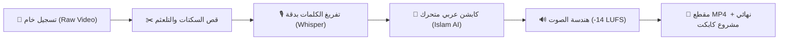

# 🎬 Islam AI ReelForge
### محرك مونتاج الريلز والفيديوهات الإعلانية بالذكاء الاصطناعي — بنقرة واحدة
> **The Complete Zero-Click AI Video & Reels Editor for Content Creators & Agencies**  
> *فكرة وتطوير: إسلام (Islam AI)*

[](LICENSE)
[](https://www.python.org/)
[](https://github.com/islamlal12)
[]()

---

## 🌟 الفكرة ببساطة (اشرح لي كأنني في العاشرة من عمري)

تخيل أن لديك **مونتير محترف وخارق للعادة** يجلس داخل جهازك:
1. تعطيه مقطع الفيديو الخام الذي صورته بكاميرتك أو بهاتفك وأنت تتكلم.
2. يكتشف بذكاء اللحظات التي سكتّ فيها أو تلعثمت ويكرر الكلام، فيقصها ويمحوها في ثوانٍ.
3. يستمع لكل كلمة تقولها، ويكتبها على الشاشة بخط عربي عصري جذاب (`Readex Pro`) وألوان حيوية خاطفة للأنظار (الأزرق والبرتقالي).
4. يضبط نقاء وقوة الصوت كأنك سجلته في استوديو إذاعي عالمي.
5. يسلمك فيديو جاهز للنشر فوراً على **إنستغرام، تيك توك، ويوتيوب شورتس**، أو يعطيك مشروع **CapCut** لتعدل عليه بنفسك إن أردت!

كل هذا يحدث **تلقائياً وبنقرة زر واحدة، دون أن تفتح أي برنامج مونتاج معقد.**



---

## ⚡ البداية السريعة في 3 خطوات فقط (بدون أي خبرة برمجية)

إذا كنت لا تفقه شيئاً في لغات البرمجة، لا تقلق! صممنا هذا النظام ليعمل بنقرة زر:

1. **حمّل هذا المستودع** على جهازك (عبر زر `Code -> Download ZIP` الأخضر بالأعلى وفك الضغط).
2. **ضع الفيديو الخاص بك** في أي مكان على جهازك.
3. **اضغط مرتين على ملف `run.bat` (لمستخدمي ويندوز)** أو شغّل `./run.sh` (لماك ولينكس).
   - اسحب ملف الفيديو وأفلته في النافذة السوداء، ثم اضغط `Enter`.
   - **انتهى!** ستجد المقطع النهائي الممنتج جاهزاً في مجلد `workspace_reel/ad-master.mp4`.

---

## 💎 المميزات الحصرية بهوية "إسلام آي" (Islam AI Standards)

تم ضبط هذا المحرك ليتبع أعلى المعايير الاحترافية المعتمدة عالمياً في صناعة المحتوى الفيروسي (Viral Short-Form Content):

| الميزة | ما الذي تفعله؟ | الفائدة لك |
| :--- | :--- | :--- |
| **محو التلعثم والسكتات تلقائياً** | يتعرف على البدايات المتعثرة، والكلمات المكررة مرتين، والوقفات الطويلة ويقصها بسلاسة. | كلامك يخرج سريعاً، واثقاً، ومشدوداً بدون أي ملل (Zero Hesitation). |
| **تفريغ صوتي عربي دقيق** | استخدام أقوى نماذج الذكاء الاصطناعي (`Whisper large-v3-turbo`) لتوقيت الكلمات بدقة أجزاء الثانية. | ظهور كل كلمة لحظة نطقها تماماً دون أي تأخير. |
| **هوية بصرية سينمائية** | خط عربي فخم (`Readex Pro-Bold`)، مع تمييز الكلمات المهمة بالبرتقالي (`#F97316`) والأزرق (`#0C68E9`). | كابشن ديناميكي يحبس بصر المشاهد ويرفع معدل الاحتفاظ بالفيديو. |
| **صوت استوديو احترافي** | معايرة الصوت تلقائياً لمعيار البث الصارم المنصات (`-14.0 LUFS`). | صوت متوازن ونقي تماماً، لا ينخفض في الهواتف ولا يتم كتمه من الخوارزميات. |
| **احترام المنطقة الآمنة (1080×1080)** | وضع كل النصوص والوجوه داخل المربع الآمن تماماً. | لن يختفي الكابشن أو جزء من وجهك خلف أزرار الإعجاب أو الوصف في تيك توك وإنستغرام. |
| **تصدير كاب كت المباشر (`CapCut`)** | استخراج مشروع CapCut مفتوح بكل طبقات النصوص والقصات والزوومات بنقرة واحدة. | حرية كاملة للتعديل اليدوي السريع قبل النشر إذا أردت لمسة إضافية. |
| **غلاف أول فريم (0.1s)** | توليد غلاف ذكي مدمج في أول فريم من الفيديو. | ضمان ظهور الغلاف المثالي لشبكة البروفايل فور رفع الفيديو على إنستغرام. |

---

## 🛠️ للمطورين وصناع الأتمتة (Pro & Agency Mode)

إذا كنت مبرمجاً أو تدير وكالة أتمتة بالذكاء الاصطناعي (AI Automation Agency)، يمكنك التحكم بكل جزء عبر سطر الأوامر (CLI):

### 1. المتطلبات البرمجية
- **Python 3.10+**
- **FFmpeg** مثبت ومضاف للـ PATH.
- **Node.js** (لتشغيل محرك حركة الكابشن والموشن).

### 2. التثبيت
```bash
git clone https://github.com/islamlal12/islam-ai-reelforge.git
cd islam-ai-reelforge
pip install -r requirements.txt
npm install
```

### 3. أوامر التشغيل المباشرة

- **المونتاج الآلي الكامل بنقرة واحدة:**
  ```bash
  python reelforge.py "my_video.mp4" --capcut
  ```

- **تخصيص مجلد العمل والمنصة المستهدفة:**
  ```bash
  python reelforge.py "interview.mov" --work "client_reel_01" --platform instagram
  ```

- **فتح استوديو الويب للمعاينة الحية والتعديل البصري:**
  ```bash
  python studio/studio.py workspace_reel
  ```

- **توليد غلاف مخصص أول فريم:**
  ```bash
  python scripts/28_cover.py workspace_reel "أكبر سر في الذكاء الاصطناعي|*لا تخبر به أحداً*" --first workspace_reel/ad-master.mp4
  ```

---

## 📂 هيكل المستودع (Project Architecture)

```
islam-ai-reelforge/
├── reelforge.py           # المنسق الرئيسي الشامل (Unified Engine Controller)
├── run.bat                # مشغل ويندوز بنقرة واحدة للمستخدم العادي
├── run.sh                 # مشغل ماك ولينكس
├── requirements.txt       # حزم بايثون المطلوبة
├── package.json           # حزم نود ومحرك الرسم
├── scripts/               # أكثر من 40 أداة متخصصة (قص، صوت، كابشن، كابكت، زوم)
├── motion/                # محرك الموشن قرافيكس، الخطوط (Readex Pro)، وقوالب 3D
├── studio/                # استوديو ويب محلي للمعاينة والتحكم بالصوت والألوان
├── references/            # أكثر من 30 مرجعاً تفصيلياً لبيئات العمل المختلفة
├── onboarding/            # واجهة إعداد الهوية وتخصيص الألوان واللوجو
└── bin/                   # أدوات معالجة الصوت المتقدمة وفلترة الضجيج
```

---

## 💼 هل تريد بناء هذا النظام لشركتك بالكامل؟ (Done-For-You Services)

هذا المستودع مجاني بالكامل كـ **Lead Magnet** لإثبات قوة الأتمتة البرمجية في صناعة المحتوى.

إذا كنت:
- **صانع محتوى كبير أو مدرباً:** وتريد نظاماً سحابياً مؤتمتاً بالكامل يستقبل مقاطعك من Google Drive أو Telegram ويمنتجها وينشرها دون أي تدخل منك.
- **شركة أو علامة تجارية:** تريد تحويل مراجعات المنتجات (UGC) إلى مئات الإعلانات البيعية أسبوعياً بتكلفة شبه صفرية.
- **وكالة تسويق:** ترغب في دمج هذا النظام داخل سيرفراتك الخاصة لتقديم خدمة المونتاج الآلي لعملائك بربحية فائقة.

📩 **تواصل مع إسلام (Islam AI):**
- **GitHub:** [@islamlal12](https://github.com/islamlal12)
- **LinkedIn / Contact:** تواصل معنا لمناقشة شراكات العمل والحلول المؤسسية المخصصة.

---

## 📄 الترخيص (License)
هذا المشروع مفتوح المصدر ومتاح تحت رخصة [MIT](LICENSE). يمكنك استخدامه، تعديله، وتطويره بحرية.
