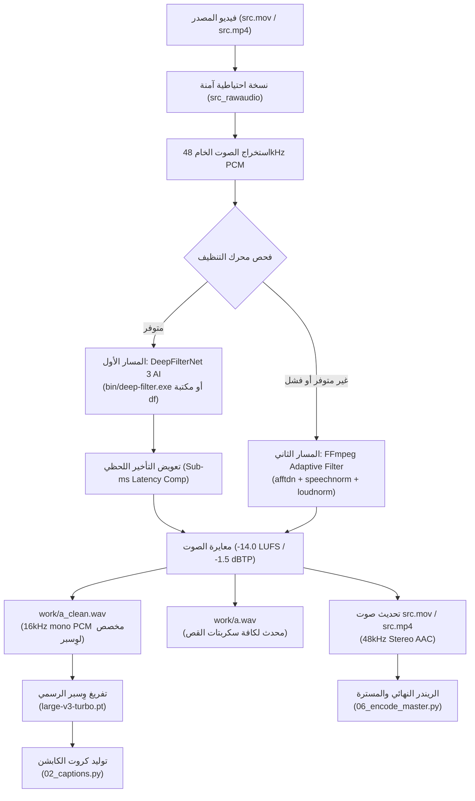

# قاعدة التنظيف الصوتي الإلزامي قبل وِسبر (Speech Denoising-First Architecture)

تُحدد هذه الوثيقة المعيار الهندسي الصارم لمعالجة الصوت وتحسين الكلام داخل منصة **Islam AI ReelForge** ومحرر الفيديو الذكي.

---

## 1. القانون الصارم: التنظيف الإلزامي قبل التفريغ (The Denoise-First Mandate)

> [!IMPORTANT]
> **يُحظر تماماً تشغيل وِسبر (Whisper) أو تفريغ الصوت مباشرة من التسجيل الخام المشوش.**
> في كل التسجيلات الواقعية وغير المحضرة مسبقاً (Unscripted & Real-life Recordings)، يحتوي صوت المتحدث على ضوضاء محيطة، همهمة مكيف الهواء، رنين الغرفة (Room Reverb)، وصوت مروحة الحاسوب.
> **يجب تنظيف وتعزيز مسار الصوت إلزامياً بواسطة DeepFilterNet 3 أو السلسلة المعيارية لـ FFmpeg قبل تمريره لنموذج وِسبر، وإنتاج `work/a_clean.wav`.**

### لماذا يُحظر تفريغ الصوت الخام؟
1. **منع هلوسات وِسبر (Zero-Hallucination Guarantee):**
   وجود ضوضاء خفيفة في الخلفية يشتت ميكانيزم الانتباه (Cross-Attention) في نماذج وِسبر، مما يؤدي إلى:
   - تكرار عبارات وهمية غير منطوقة.
   - سقوط كلمات أو مقاطع كاملة.
   - انحراف توقيتات الكلمات (Word Timestamps) بمقدار يتجاوز 0.3 إلى 0.8 ثانية، مما يدمر تزامن كروت الكابشن الحركية.
2. **وضوح بلوري لصوت المتحدث (Crystal-Clear Vocal Dominance):**
   التنظيف قبل المونتاج يضمن أن كافة عمليات قص السكتات (`01_cut_plan.py`)، كروت الكابشن (`02_captions.py`)، وتقطيع الفيديو (`03_cut_zoom.py`) تعتمد على مسار كلام ناصع ومعاير.
3. **معيار المنصات القياسي (-14.0 LUFS / -1.5 dBTP):**
   الصوت المعالج يتم دمجه في فيديو المصدر ومسترته نهائياً لمعيار المنصات القياسي لضمان علو الصوت وتفوقه على الفيد دون أي تشويه رقمي (Clipping).

---

## 2. المعمارية الصوتية ثنائية المسار (Dual-Tier Audio Architecture)

تعتمد المنظومة على مسار ذكي مزدوج لا يفشل أبداً تحت أي بيئة نظام:



### المسار الأول: DeepFilterNet 3 (AI Deep Speech Enhancement)
- يعمل بتردد 48,000 Hz.
- يقوم بعزل الصوت البشري وإلغاء كافة ترددات الضوضاء الخلفية دون التأثير على الترددات الحيوية لنطق الحروف العربية.
- حساب وإلغاء تأخير الفلاتر (Delay Compensation) تلقائياً عبر الارتباط المتبادل للـ FFT (`lag_of(dry, wet)`).
- استخدام الأداة التنفيذية المدمجة في المستودع `bin/deep-filter.exe` (أو الكاش `~/.cache/reelforge/bin/`).

### المسار الثاني: الفلتر الطيفي الذكي لـ FFmpeg (Zero-Dependency Robust Fallback)
إذا لم تتوفر مكتبة أو أداة DeepFilterNet، يتم تفعيل سلسلة فلاتر FFmpeg الرياضية المركبة:
```bash
afftdn=nf=-25:tn=1,highpass=f=75,lowpass=f=11000,speechnorm=e=4:r=0.0001:l=1,loudnorm=I=-14:TP=-1.5:LRA=7
```
- `afftdn=nf=-25:tn=1`: إزالة الضجيج بالطرح الطيفي التكيفي وتتبع الضوضاء المتغيرة.
- `highpass=f=75`: قطع الترددات تحت 75Hz (همهمة المكيف واهتزازات الطاولة).
- `lowpass=f=11000`: قطع الترددات فوق 11,000Hz (الصفير الإلكتروني وضجيج الدوائر).
- `speechnorm=e=4:r=0.0001:l=1`: موازنة ديناميكية متقدمة لمستوى صوت الكلام.
- `loudnorm=I=-14:TP=-1.5:LRA=7`: معايرة EBU R128 لبلوغ -14.0 LUFS و-1.5 dB True Peak بدقة متناهية.

---

## 3. مصفوفة الملفات المعتمدة في مجلد العمل (Workspace Artifacts)

| اسم الملف | الصيغة والمواصفات | الغرض والدور |
|---|---|---|
| `src_rawaudio.mov` / `.mp4` | الفيديو الأصلي غير الملموس | نسخة أمان احتياطية تضمن إمكانية إعادة التنظيف دون تدهور الجودة. |
| `a_clean.wav` | 16kHz · Mono · 16-bit PCM | **الملف الإلزامي لتفريغ وِسبر**؛ خالٍ من أي ضوضاء لضمان دقة 100%. |
| `a.wav` | 16kHz · Mono · 16-bit PCM | مسار متزامن ومطابق لـ `a_clean.wav` لدعم `01_cut_plan.py` والتوافق القديم. |
| `src.mov` / `src.mp4` | 48kHz · Stereo AAC (-14 LUFS) | الفيديو النشط الذي يُقص منه `cutz.mp4` لضمان نظافة صوت الفيديو النهائي. |
| `ad-final.mp4` / `ad-master.mp4` | 48kHz AAC (-14.0 LUFS / -1.5 dBTP) | النسخة النهائية المصدرة للإنستغرام وتيك توك وفق معايير البث. |

---

## 4. التكامل البرمجي وسير العمل (Workflow Integration)

### 1) تشغيل التنظيف عبر سطر الأوامر (CLI)
```bash
# تنظيف مسار الصوت وتوليد a_clean.wav
python scripts/02c_denoise.py <workspace> --strength 0.85

# التنظيف المسبق لوِسبر حصراً
python scripts/02c_denoise.py <workspace> --pre-whisper

# إجبار محرك معين
python scripts/02c_denoise.py <workspace> --engine dfn      # DeepFilterNet فقط
python scripts/02c_denoise.py <workspace> --engine ffmpeg   # FFmpeg Adaptive فقط
```

### 2) الاستدعاء البرمجي داخل بايثون (Python API)
```python
from scripts.02c_denoise import prepare_clean_audio_for_whisper

# يقوم بالتنظيف، تحديث الفيديو، وتوليد a_clean.wav
clean_audio_path = prepare_clean_audio_for_whisper(
    work_dir="workspace_reel",
    strength=0.85,
    engine="auto"
)
print(f"Clean audio ready for Whisper: {clean_audio_path}")
```

### 3) تفريغ وِسبر بالصوت النظيف (`01b_transcribe.py`)
```bash
python scripts/01b_transcribe.py <workspace> --model "C:\Users\PC\.cache\whisper\large-v3-turbo.pt"
```
*يقوم السكربت تلقائياً بفحص `a_clean.wav`، وإذا لم يجده يبدأ عملية التنظيف الذاتي أولاً قبل مناداة وِسبر.*

### 4) بناء الكابشن التلقائي (`02_captions.py`)
```bash
python scripts/02_captions.py <workspace>
```
*يتحقق تلقائياً من وجود `a_clean.wav`، ويربط توقيتات الكابشن ومطابقة الكلمات بمسار الصوت المنظف.*

---

## 5. نموذج وِسبر الدائم (Permanent Whisper Model)

وفق القواعد القياسية، يتم دائماً استخدام المودل المخزن محلياً:
- **المسار الدائم:** `C:\Users\PC\.cache\whisper\large-v3-turbo.pt`
- **اللغة:** `ar` (العربية).
- **مستوى التوقيت:** Word-level timestamps مفعلة دائماً بدقة الفريم.
- **تصفية التلعثم:** إزالة التكرارات المباشرة والبدايات المتعثرة آلياً قبل كتابة `a.json`.
