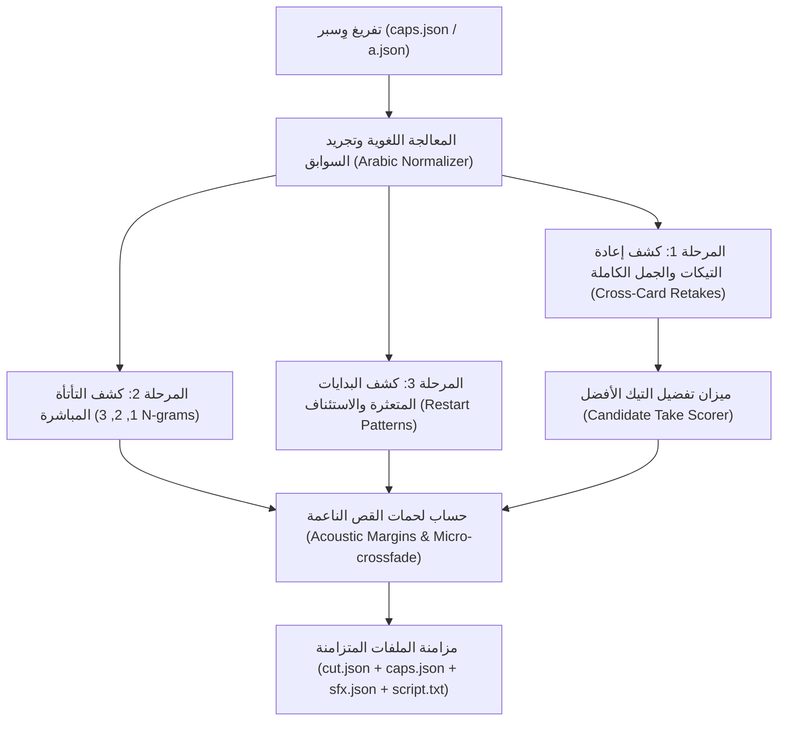

<!-- مرجع لسكل video-ad-editor و AI Video Forge — يُقرأ عند معالجة التسجيلات العفوية والتكرارات -->

# محو التكرارات والبدايات المتعثرة واختيار أفضل تيك (Speech Deduplication Specialist)

دليل شامل لهندسة وخوارزميات استئصال التكرارات، التأتأة، والبدايات المتعثرة في التسجيلات العفوية (Unscripted Speech)، واختيار أفضل محاولة أداء (Master Take Selection)، وحساب لحمات قص ناعمة بلا رمشات صورية أو طقطقة صوتية.

---

## 1. المشكلة الهندسية: عثرات التسجيل العفوي (Unscripted Speech Traps)

عندما يتحدث صانع المحتوى أمام الكاميرا دون قراءة نص حرفي من تلقين (Teleprompter)، يقع تلقائياً في ثلاث ظواهر صوتية تقلل من احترافية الفيديو وتعيق انتباه المشاهد:

1. **التأتأة والتكرار المتتالي (N-gram Stutters):**
   - تكرار كلمة أو كلمتين أو ثلاث في نفس اللحظة:
     - 1-gram: `"هذا هذا التطبيق..."`
     - 2-gram: `"علشان كذا علشان كذا لازم..."`
     - 3-gram: `"زي ما تشوفون زي ما تشوفون الحين..."`
2. **البدايات المتعثرة وإعادة الاستئناف (False Starts & Restart Patterns):**
   - بدء جملة بكلمة أو كلمتين ثم التوقف لبرهة وإعادة نفس البداية مع الاسترسال:
     - `"أنا اليوم... [وقفة تردد] أنا اليوم جاي أحكيلكم عن أكبر تحدي"`
     - `"طريقة التسجيل... طريقة التسجيل في الموقع سهلة جداً"`
3. **إعادة صياغة الجملة أو التيك كاملاً (Sentence / Take Retakes):**
   - التحدث بجملة كاملة ثم عدم الرضا عن النبرة أو مخارج الحروف، فيسكت المتحدث ويعيد صياغة الجملة كاملة بنبرة أوضح أو كلمات أكثر دقة:
     - **المحاولة الأولى (False Take):** `"واليوم راح نشوف كيف نطبق الذكاء الاصطناعي"` (توقف أو تردد).
     - **المحاولة الثانية (Master Take):** `"واليوم راح نشوف كيف نطبق أدوات الذكاء الاصطناعي في حياتنا اليومية بسهولة"`.

---

## 2. المعمارية الهندسية ومراحل المعالجة (Pipeline Architecture)

يعتمد المحرك المطور في `scripts/01b_dedup.py` والمدمج في `scripts/10_script_edit.py` على 4 مراحل خوارزمية متتابعة:



---

## 3. المعالجة اللغوية للنص العربي العفوي (Arabic Dialectal Normalization)

يتعامل المحرك مع خصوصية اللهجات العربية والزوائد الموصولة عبر مستويين من التجريد:

### المستوى الأول: التوحيد الإملائي الصوتي (Orthographic Normalization)
- حذف علامات التشكيل والتنوين (`\u064B-\u0652`) والتطويل (`\u0640`) وعلامات الوقف.
- توحيد صور الألف: `[أ، إ، آ، ٱ]` $\rightarrow$ `ا`.
- توحيد التاء المربوطة والهاء: `ة` $\rightarrow$ `ه`.
- توحيد الياء والألف المقصورة: `[ى، ي]` $\rightarrow$ `ي`.
- توحيد كراسي الهمزة: `ؤ` $\rightarrow$ `و`، `ئ` $\rightarrow$ `ي`.

### المستوى الثاني: تجريد السوابق اللهجية والموصولة (Stemming & Prefix Stripping)
في الكلام العفوي، قد يبدأ المتحدث التيك بـ `"اليوم"` ثم يعيده بـ `"واليوم"` أو `"فاليوم"` أو `"هاليوم"`. يقوم التجريد بمطابقتها كجذر واحد:
- سوابق ثلاثية: `"والـ"`، `"فالـ"`، `"هالـ"`، `"بالـ"` (بشرط ألا يقل طول الكلمة عن 6 أحرف).
- سوابق ثنائية: `"الـ"`، `"للـ"` (بشرط ألا يقل الطول عن 5 أحرف).
- سوابق أحادية: `"و"`، `"ف"`، `"ب"`، `"ل"` (مع حماية الجذور الأصلية مثل *وفد*، *وقت*، *فهم*، *بيت*).

---

## 4. ميزان تقييم واختيار أفضل محاولة (Candidate Take Scorer)

عند وجود محاولتين منطوقتين لنفس المعنى، لا يتم الحذف عشوائياً، بل عبر معادلة نقاط رياضية دقيقة تفاضل بين المحاولتين:

$$\text{Score}(T) = 1.5 \cdot N_{\text{words}} + S_{\text{order}} - 2.0 \cdot H_{\text{gaps}} + 2.0 \cdot P_{\text{whisper}}$$

حيث:
1. **معيار الاكتمال والطول ($1.5 \cdot N$):** يمنح 1.5 نقطة لكل كلمة. الجملة الكاملة المكتملة الأركان تتفوق على البدايات المبتورة التي انقطعت في المنتصف.
2. **أفضلية الإعادة اللاحقة ($S_{\text{order}} = +3.0$):** في التسجيل العفوي، لا يعيد المتحدث الجملة إلا لأن المحاولة السابقة تضمنت خطأً في الإلقاء أو تعثراً. لذلك تمنح المحاولة الثانية أو الأخيرة مكافأة حتمية $+3.0$.
3. **خصم وقفات التردد والتعثر ($H_{\text{gaps}}$):** يخصم 2.0 نقطة عن كل وقفة داخلية غير طبيعية بين الكلمات تزيد عن 0.35 ثانية.
4. **ثقة نموذج وِسبر ($P_{\text{whisper}}$):** ترجيح الكلمات ذات النطق الواضح ومخارج الحروف السليمة.

> **النتيجة:** المحاولة الحائزة على السكور الأعلى تُعتمد كـ **Master Take**، بينما تُحذف المحاولة المتعثرة السابقة بالكامل من مسار الفيديو والصوت.

---

## 5. لحمات القص الناعمة ومنع الطقطقة (Zero-Glitch Cutting & Micro-Crossfade)

القص العشوائي المباشر على أول فريم للكلمة يسبب تشوهات شائعة:
- **بتر طاقة الهجوم الصوتي الأولى ($F_0$ Frame Attack):** الحروف الانفجارية والاحتكاكية (مثل ب، ت، ك، ف، س) تمتلك طاقة صوتية تسبق الحرف بـ 20-30ms.
- **طقطقة الطور الصوتي (Clicks/Pops):** قطع الموجة الصوتية عند سعة غير صفرية (Non-Zero Crossing).
- **رمشة حركة الفم (Mouth Glitch):** قفزة في عضلات الوجه عند بداية نطق خاطئ.

### قواعد الهوامش الصوتية المعتمدة:
- **هامش قبل الكلمة المعتمدة (`PAD_ATTACK = 35ms`):** ترك 35ms قبل بداية الكلمة المعتمدة لحماية هجوم الحرف ونعومة حركة الفم.
- **هامش بعد الكلمة السابقة (`PAD_RELEASE = 40ms`):** ترك 40ms بعد نهاية الكلمة السابقة لمنع بتر الحروف الممدودة.
- **ميكرو-كروس فيد (`MICRO_MARGIN = 8ms`):** فاصل تنعيم يمنع أي نقرة رقمية في ملف الـ PCM/WAV.
- **الحد الأدنى للمقطع في `cut.json` (`MIN_SEG = 0.15s`):** استبعاد أي بقايا قص أقل من 150ms لمنع الفلاشات والفريمات الطائرة.

---

## 6. أوامر الاستخدام وسطر الأوامر (CLI Commands)

### 1) الفحص والمعاينة (Inspection Mode)
```bash
# فحص المجلد واستعراض كافة التكرارات مع المقارنة ونسبة الاختصار المتوقعة
python scripts/01b_dedup.py <work_dir>

# أو عبر سكربت التحرير المحدث:
python scripts/10_script_edit.py <work_dir> dedup
```

### 2) التطبيق الفعلي وحذف التكرارات (Apply Mode)
يقوم بقص التكرارات وتعديل `cut.json` و `caps.json` و `sfx.json` و `script.txt` تلقائياً مع حفظ نسخ احتياطية `.bak` و `.orig`:
```bash
python scripts/01b_dedup.py <work_dir> --apply

# أو:
python scripts/10_script_edit.py <work_dir> dedup --apply
```

### 3) إخراج تقرير تقني JSON (Agent/Automation Mode)
```bash
python scripts/01b_dedup.py <work_dir> --json
```

### 4) التراجع واستعادة النسخة الأصلية (1-Click Undo)
```bash
python scripts/01b_dedup.py <work_dir> --undo
# أو:
python scripts/10_script_edit.py <work_dir> undo
```

---

## 7. إعدادات الحساسية المتقدمة (Threshold Tuning)

| المعامل | الافتراضي | الوصف |
|---|---|---|
| `--threshold` | `0.60` | نسبة التشابه المعجمي المطلوبة لاعتبار جملتين إعادتين لنفس التيك (60%). |
| `--min-gap` | `0.20` | أقل مدة وقفة صامتة (بالثواني) لاعتبار تكرار الكلمة بداية متعثرة (False Start). |
| `--max-ngram` | `3` | أقصى عدد كلمات متتالية يتم فحص تأتأتها المباشرة (1, 2, 3 كلمات). |

---

## 8. ما بعد الحذف: تسلسل إعادة الرندر

بعد تطبيق الحذف التلقائي، يتم تحديث التايم لاين تلقائياً، والخطوات التالية لإعادة بناء الفيديو هي:

```bash
# 1. قص وتوليد الفيديو المحدث بالزومات
python scripts/03_cut_zoom.py <work_dir>

# 2. استخراج الفريمات الجديدة
mkdir -p <work_dir>/vfr && ffmpeg -v error -i <work_dir>/cutz.mp4 -vf fps=30 -q:v 3 -y <work_dir>/vfr/%05d.jpg

# 3. إعادة رسم طبقات التصميم والكابشن المحدث
node scripts/04_render_frames.js <work_dir> all --force
```
